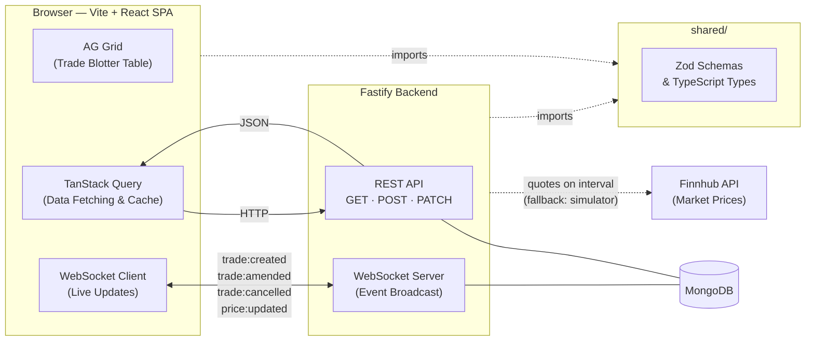

# tpicap-blotter

A full-stack trade blotter application for viewing and managing equity trades in real time, built as a take-home engineering assessment.

---

## Architecture



### How it fits together

- **Frontend** — a Vite + React SPA. AG Grid renders the trade blotter table with sorting, filtering, and row-level actions. TanStack Query manages all data fetching and caching. A WebSocket client receives trade events and updates the TanStack Query cache directly via `setQueryData`, keeping every connected client in sync without page refreshes.
- **Backend** — a Fastify server exposing a REST API for CRUD operations and a WebSocket server for broadcasting trade events and live price updates to all connected clients. Market prices are fetched from Finnhub; the price simulator is used as a fallback when Finnhub is unavailable.
- **Shared** — a `shared/` package containing Zod schemas and inferred TypeScript types. Both the frontend and backend import from it, ensuring validation rules and types are defined once and consistent across the stack.
- **Database** — MongoDB. Trades are stored as documents. On first startup, if no trades exist, the backend seeds the database with a realistic randomised dataset.

For the full reasoning behind each technology choice, see [`docs/decisions/`](docs/decisions/).

---

## Project Structure

```
tpicap-blotter/
├── frontend/          # Vite + React + TypeScript SPA
├── backend/           # Fastify API server + WebSocket server
├── shared/            # Zod schemas and TypeScript types
├── database/          # Seed scripts and MongoDB setup notes
├── docs/
│   ├── assessment/    # Original brief
│   ├── specs/         # Feature specifications
│   ├── decisions/     # Architecture Decision Records (ADRs)
│   └── ai/            # AI usage report and prompt log
└── README.md
```

---

## Installation

> Prerequisites: Node.js 20+, pnpm, MongoDB 7

### MongoDB

MongoDB must be running on `localhost:27017` before starting the backend.

**macOS (Homebrew):**
```bash
brew tap mongodb/brew
brew install mongodb-community
brew services start mongodb-community
```

**Docker:**
```bash
docker run -d --name mongo -p 27017:27017 mongo:7
```

Verify it is running: `mongosh --eval "db.runCommand({ ping: 1 })"` should print `{ ok: 1 }`.

### Application

```bash
# Clone the repository
git clone <repo-url>
cd tpicap-blotter

# Install dependencies across all packages
pnpm install
```

### Environment variables

```bash
# backend/.env
MONGODB_URI=mongodb://localhost:27017/tpicap-blotter
PORT=3000
FINNHUB_API_KEY=your_key_here   # optional — price simulator runs if unset

# frontend/.env
VITE_API_URL=http://localhost:3000
VITE_WS_URL=ws://localhost:3000
```

---

## Running the Application

```bash
# Start the backend
pnpm --filter backend dev

# Start the frontend (in a separate terminal)
pnpm --filter frontend dev
```

| Service | URL |
|---|---|
| Frontend | http://localhost:5173 |
| Backend API | http://localhost:3000 |

On first run, if no trades exist in the database, the backend automatically seeds 100–500 randomised trades.

---

## Running Tests

```bash
# All packages
pnpm test

# Individual packages
pnpm --filter shared test
pnpm --filter backend test
pnpm --filter frontend test
```

---

## Assumptions

- All users are trusted — no authentication or authorisation is implemented
- Trades cannot transition from `CANCELLED` back to `ACTIVE`
- Currency is USD throughout
- The seed data is generated once on startup and not regenerated on subsequent runs
- A single MongoDB database is used for all environments

---

## Trade-offs

- **No authentication** — out of scope for this assessment; all clients have full read/write access
- **No pagination** — the full trade list is fetched on load and filtered client-side; acceptable at the data volumes required by the assessment (100–1,000 trades)
- **No end-to-end tests** — unit and integration tests cover the critical paths; e2e automation would require additional tooling and time
- **No Docker support** — listed as optional in the assessment brief; deferred in the interest of time

---

## Further Reading

- [Feature Specs](docs/specs/) — detailed requirements and acceptance criteria per feature
- [Architecture Decision Records](docs/decisions/) — the reasoning behind technology choices
- [AI Usage Report](docs/ai/ai-usage-report.md) — how AI tools were used during development
- [Prompt Log](docs/ai/prompt-log.md) — representative sample of significant prompts
